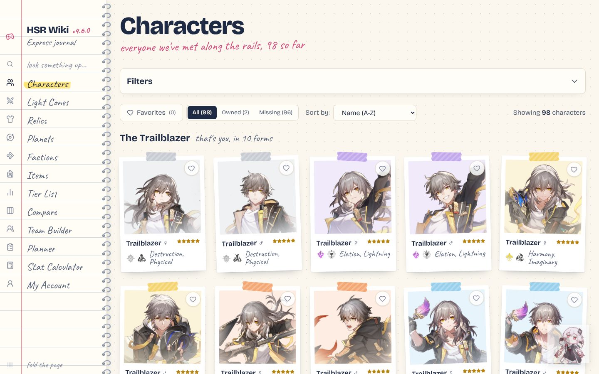
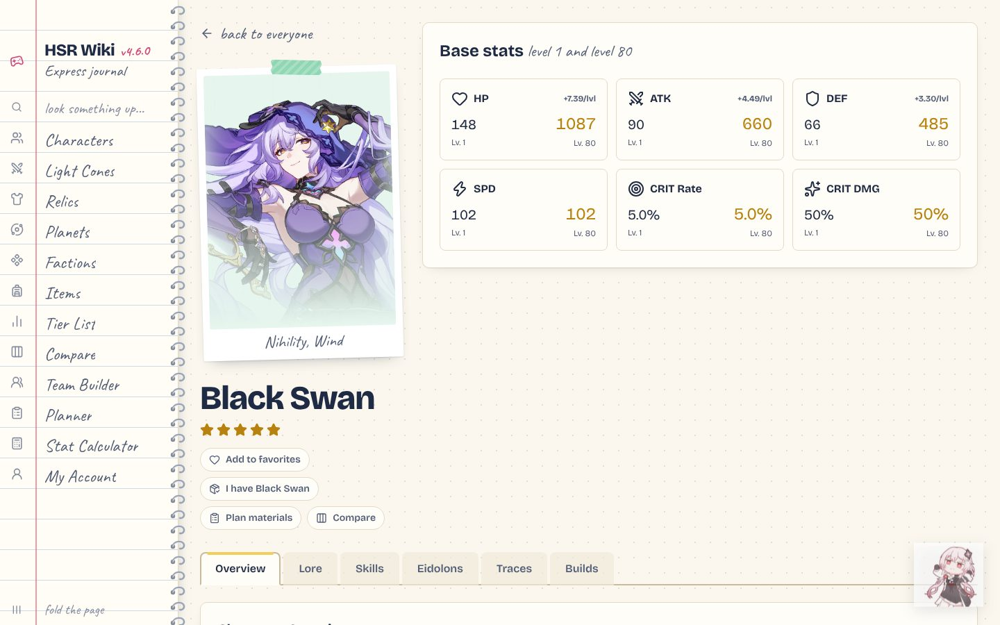
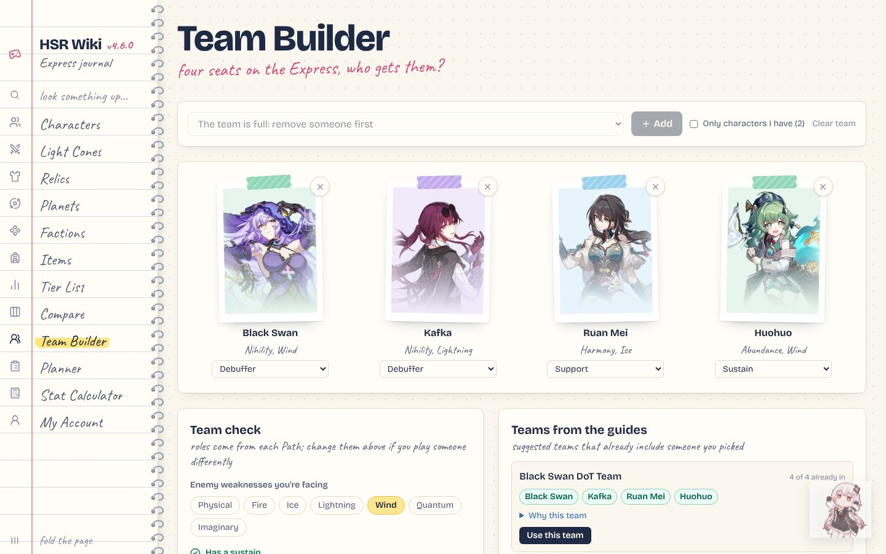
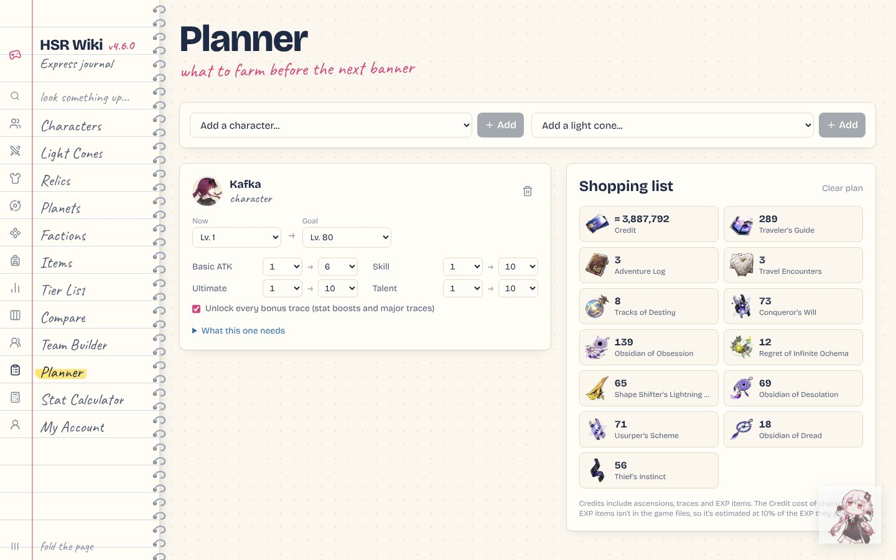
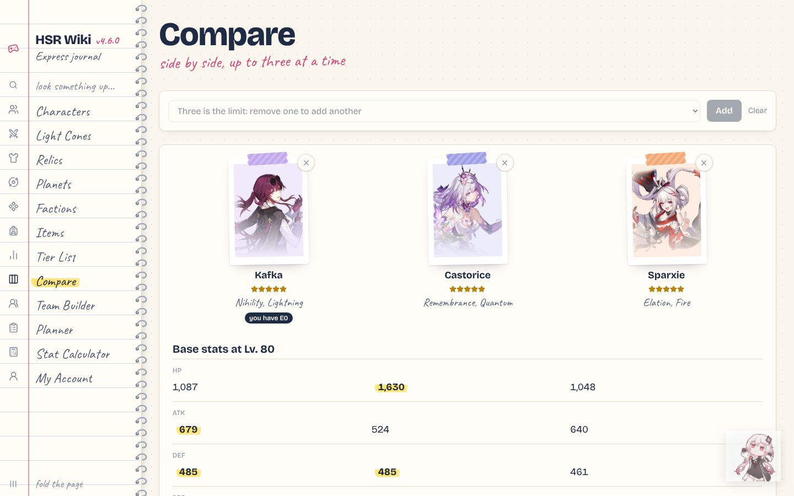

<div align="center">

# HSRWiki — Frontend

**An unofficial Honkai: Star Rail wiki and toolbox, styled as the Astral Express's travel journal.**


[Backend repository](https://github.com/CristianFiguerolaVicedo/HSRWiki-backend) ·
[Features](#features) ·
[Getting started](#getting-started) ·
[Deployment](#deployment)



</div>

---

## Overview

HSRWiki brings together everything a Honkai: Star Rail player looks up between sessions: every character, light cone, relic, planet, faction and item of the game, recommended builds and teams, and tools to plan materials, compute stats and check your own in-game builds. Game data is served by the [HSRWiki backend](https://github.com/CristianFiguerolaVicedo/HSRWiki-backend) and is up to date with version 4.6.

The interface follows a "travel journal" design: a ruled notebook index as navigation, characters as taped photo cards, and handwritten notes, while keeping the information clear and easy to scan on desktop and mobile.

## Features

### Wiki

- **Characters:** filters by element, Path and rarity; base stats, skills, Eidolons, traces and enhanced kits; recommended light cones, relics, stats and teams; and the full in-game Character Archive (stories and voice actors).
- **Skill levels:** every skill shows its values at any level, with the real in-game caps and the extra levels from Eidolons.
- **Light cones, relics and planar ornaments,** each with its own page.
- **Planets and factions** of the Star Rail universe, and **items** with their descriptions and the characters and light cones that use them.
- **Tier list** of characters.

### Tools

| Tool | What it does |
|---|---|
| **My Account** | Enter your UID to see your in-game showcase (through Enka.Network, no login) and how each build compares with the guides |
| **Planner** | Materials, EXP items and Credits needed to level characters, skills, traces and light cones |
| **Stat Calculator** | Final stats from a character, light cone, relic sets, main stats and substats, or loaded from your showcase |
| **Compare** | Up to three characters side by side: stats, traces, skills, Eidolons and builds |
| **Team Builder** | Checks a four-character team (sustain, damage, roles, enemy weaknesses) and suggests teams from the guides |
| **Favorites and collection** | Mark favorites and the characters and light cones you own (with Eidolons and Superimpositions), filter by them and import them from your showcase |

Favorites, collection, plans and teams are stored in the browser (`localStorage`), so no account is needed.

## Screenshots

| Character page | Team Builder |
|---|---|
|  |  |
| **Planner** | **Compare** |
|  |  |

## Tech stack

| Area | Technology |
|---|---|
| UI | React 19, React Router 7 |
| Styling | Tailwind CSS 4, custom design tokens, Bricolage Grotesque and Caveat fonts |
| Data | Axios, against the HSRWiki REST API |
| Icons | lucide-react |
| Tooling | Vite 7, ESLint 9 |

## Project structure

```
src/
├── pages/        One file per section (Characters, Light Cones, Planner, Team Builder...)
├── components/   Cards, detail pages, filters, sidebar and shared pieces
├── hooks/        Data and browser-storage hooks (characters, favorites, collection)
├── services/     API client
├── util/         Pure logic: planner maths, stat calculator, team checks, skill levels
├── App.jsx       Routes
└── index.css     Design tokens and the journal styles
```

## Getting started

### Requirements

- **Node.js 20.19+** (required by Vite 7) and npm
- The [HSRWiki backend](https://github.com/CristianFiguerolaVicedo/HSRWiki-backend) running locally or deployed

### Run locally

```bash
git clone https://github.com/CristianFiguerolaVicedo/HSRWiki-frontend.git
cd HSRWiki-frontend
npm install
npm run dev
```

Open the address Vite prints (`http://localhost:5173` by default).

### Scripts

| Command | Description |
|---|---|
| `npm run dev` | Development server with hot reload |
| `npm run build` | Production build in `dist/` |
| `npm run preview` | Serves the production build locally |
| `npm run lint` | Runs ESLint |

### Configuration

| Variable | Default | Description |
|---|---|---|
| `VITE_API_BASE_URL` | `http://localhost:8080/api` | Address of the HSRWiki API |

Set it in a `.env` file (ignored by git) or in your hosting provider's settings:

```bash
VITE_API_BASE_URL=https://your-backend.onrender.com/api
```

## Deployment

**Vercel (free plan)**

1. **Add New → Project**, import this repository. Vite is detected automatically.
2. Add the environment variable `VITE_API_BASE_URL` with the backend's address plus `/api`.
3. Deploy. Every push to `main` redeploys automatically.

`vercel.json` sends every route to `index.html`, so opening or reloading a page like `/char/1005` works. Remember to add the frontend's address to the backend's `HSRWIKI_CORS_ALLOWEDORIGINS` variable.

## Credits

- Game data and images from [Mar-7th/StarRailRes](https://github.com/Mar-7th/StarRailRes), served by the HSRWiki backend.
- Player showcases from [Enka.Network](https://enka.network).
- Icons by [Lucide](https://lucide.dev).

## Disclaimer

HSRWiki is a fan-made project and is not affiliated with or endorsed by HoYoverse. Honkai: Star Rail and all related names, characters and images are trademarks and copyright of HoYoverse.
